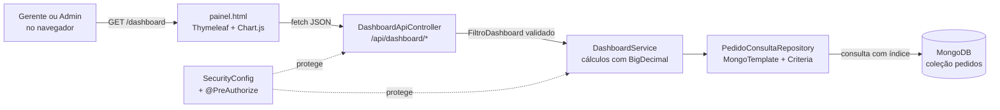

# Dashboard Administrativo — PediuPatrão

**Aluno:** Lucas Mateus Sureira
**Atividade:** Atividade Prática — Dashboard Administrativo (M2)
**Branch da implementação (gitflow):** `feature/dashboard-api` → `develop` → `main`

Este documento reúne a análise, o projeto e as decisões do Dashboard Administrativo integrado ao sistema de pedidos PediuPatrão.

| Documento | Conteúdo |
|---|---|
| Este arquivo | Contexto, requisitos funcionais e não funcionais, regras de cálculo, arquitetura e decisões de projeto |
| [API-DASHBOARD.md](API-DASHBOARD.md) | Documentação dos endpoints: parâmetros, exemplos de requisição e resposta, erros |
| [EVIDENCIAS-TESTES.md](EVIDENCIAS-TESTES.md) | Testes automatizados, testes da API e telas do dashboard funcionando |

---

## 1. Contexto e objetivo

O responsável pela pizzaria precisa acompanhar o desempenho das vendas sem abrir pedido por pedido. O dashboard responde a perguntas como:

- Quanto vendemos no período, e isso é mais ou menos que no período anterior?
- Quantos pedidos estão em preparo ou a caminho agora?
- Quais dias da semana e horários concentram os pedidos?
- Quais produtos mais vendem?
- Quantos pedidos estão sendo cancelados?

**Quem usa:** perfis **ADMIN** e **GERENTE** (o "responsável pelo estabelecimento"). O ATENDENTE não acessa o dashboard: ele trabalha no balcão e não precisa de dados de faturamento.

**Fonte de dados:** os pedidos já registrados pelo sistema (coleção `pedidos` do MongoDB), com os itens, valores, status, entrada e saída criados na Parte 2.

---

## 2. Requisitos funcionais

| ID | Requisito | Critérios de aceitação | Onde está |
|---|---|---|---|
| **RF01** | Indicadores gerais de vendas | Exibir faturamento, pedidos válidos, ticket médio, cancelamentos (quantidade e taxa), descontos concedidos, itens vendidos e tempo médio até a saída. Os três primeiros mostram a variação (%) em relação ao período anterior de mesmo tamanho. | `GET /api/dashboard/indicadores` · cartões do topo da tela |
| **RF02** | Análise de vendas (gráficos) | Gráfico de vendas ao longo do período agrupado por **dia, semana ou mês**, alternando entre faturamento e número de pedidos. Gráfico de pedidos por **hora do dia** mostrando o horário de pico. Intervalos sem venda aparecem com zero. | `GET /api/dashboard/vendas` · `GET /api/dashboard/vendas/por-hora` |
| **RF03** | Situação dos pedidos | Quantidade e percentual de pedidos em cada um dos 7 status (inclusive os zerados), total em andamento e lista dos pedidos mais recentes com link para o detalhe. | `GET /api/dashboard/pedidos/status` · `GET /api/dashboard/pedidos/recentes` |
| **RF04** | Produtos mais vendidos | Ranking de produtos por **quantidade** ou por **faturamento**, com posição e participação (%). Pedidos cancelados não entram. | `GET /api/dashboard/produtos/mais-vendidos` |
| **RF05** | Filtros de consulta | Filtrar por data inicial, data final, status e modalidade (entrega/retirada), com atalhos (hoje, 7 dias, 30 dias, este mês, 90 dias). Os mesmos filtros valem para todos os indicadores, gráficos e listas. As opções dos campos vêm da API. | Parâmetros `inicio`, `fim`, `status`, `modalidade` em todos os endpoints · `GET /api/dashboard/filtros` |
| **RF06** | Integração com a API | A tela não calcula nada sozinha: todos os números vêm dos endpoints REST, em JSON, que consultam o MongoDB. A API pode ser usada por outro cliente (app, planilha, BI). | `DashboardApiController` · `painel.html` (fetch) |
| **RF07** | Atualização e tratamento de dados | Atualização automática configurável (30 s, 1 min, 5 min ou desligada) e botão "Atualizar agora", com o horário da última atualização. Mensagens claras para filtro inválido (400), sessão expirada (401), falta de permissão (403) e banco indisponível (503). Dados antigos incompletos (sem valor, status ou itens) não quebram os cálculos. Estados de "carregando" e "sem dados no período". | `RespostaDashboard.geradoEm` · `ApiExceptionHandler` · `DashboardService` |

---

## 3. Requisitos não funcionais

| ID | Categoria | Requisito | Como foi atendido |
|---|---|---|---|
| **RNF01** | Segurança | Apenas ADMIN e GERENTE acessam o dashboard e a API; a API é somente leitura. | Regra de URL no `SecurityConfig` (`GET` liberado só para ADMIN/GERENTE; `POST/PUT/DELETE` negados) **e** `@PreAuthorize` em cada método do `DashboardService`. Testado em `DashboardApiTest`. |
| **RNF02** | Precisão | Valores monetários sem erro de arredondamento. | `BigDecimal` com 2 casas e `RoundingMode.HALF_UP`; percentuais com 1 casa. Nada de `double` em dinheiro. |
| **RNF03** | Desempenho | Resposta de cada endpoint em menos de 1 segundo para o volume de uma pizzaria (milhares de pedidos por ano). | Filtro de período aplicado **no MongoDB** com índice `idx_pedidos_dataHoraEntrada`; período máximo de 366 dias; ranking e listas com limite de 1 a 50. |
| **RNF04** | Usabilidade | Tela legível e utilizável em computador e celular. | Layout responsivo (Bootstrap), números com formato brasileiro (R$ 1.234,56 e 12,3%), gráficos sem eixo duplo, rótulos em português. |
| **RNF05** | Confiabilidade | Uma falha numa parte não derruba a tela toda. | As seções são carregadas em paralelo (`Promise.allSettled`); cada uma mostra seu próprio erro. |
| **RNF06** | Manutenibilidade | Código organizado em camadas e testado. | Controller → Service → Repository; DTOs como `record`; validação de filtros num único lugar (`FiltroDashboard`); 3 classes de teste novas. |
| **RNF07** | Interoperabilidade | API documentada, previsível e independente da tela. | Envelope padrão `{filtros, geradoEm, dados}`; erros sempre em JSON com `status`, `mensagem` e `campo`. |
| **RNF08** | Privacidade | O dashboard não expõe dados pessoais além do necessário. | Só o nome do cliente aparece na lista de recentes; telefone e endereço não saem pela API do dashboard. |

---

## 4. Regras de cálculo

Definir cada número evita interpretações diferentes entre quem programa e quem lê o painel.

| Indicador | Regra |
|---|---|
| Pedido **válido** | Qualquer status diferente de `CANCELADO`. Pedido cancelado não é venda. |
| **Faturamento** | Soma do `valorTotal` (já com desconto) dos pedidos válidos. |
| **Ticket médio** | Faturamento ÷ pedidos válidos (0 quando não há pedidos). |
| **Taxa de cancelamento** | Cancelados ÷ total de pedidos × 100. |
| **Descontos concedidos** | Soma do `valorDesconto` dos pedidos válidos. |
| **Em andamento** | Status `RECEBIDO`, `EM_PREPARACAO`, `PRONTO`, `SAIU_PARA_ENTREGA` ou `RETIRADO`. |
| **Tempo médio até a saída** | Média, em minutos, entre `dataHoraEntrada` e `dataHoraSaida`, só dos pedidos que já saíram. |
| **Variação %** | (atual − anterior) ÷ anterior × 100, comparando com o período imediatamente anterior de mesmo tamanho (ex.: 01–10/11 compara com 22–31/10). Fica vazia quando o período anterior é zero, para não mostrar "+∞%". |
| **Ranking — faturamento do produto** | Soma dos subtotais dos itens (preço × quantidade). O desconto é dado sobre o pedido inteiro, por isso não é rateado entre os itens. |
| **Data do pedido** | `dataHoraEntrada`. O filtro "de 01/11 a 10/11" pega de 01/11 00:00 até 10/11 23:59:59. |

---

## 5. Arquitetura



### Classes criadas ou alteradas

| Camada | Classe | Papel |
|---|---|---|
| Controller | `DashboardController` | Abre a página `/dashboard`. |
| Controller | `DashboardApiController` | 7 endpoints REST; converte parâmetros e delega ao serviço. |
| DTO | `FiltroDashboard` | Lê e **valida** os filtros (datas, status, modalidade) e calcula o período anterior. |
| DTO | `RespostaDashboard`, `IndicadoresDTO`, `PontoSerieDTO`, `StatusPedidosDTO`, `ProdutoRankingDTO`, `PedidoResumoDTO`, `OpcoesFiltroDTO` | Formato das respostas (records imutáveis). |
| DTO | `Agrupamento`, `CriterioRanking` | Valores aceitos para agrupamento e critério de ranking. |
| Service | `DashboardService` | Regras de cálculo da seção 4. |
| Repository | `PedidoConsultaRepository` | Consulta filtrada no MongoDB. |
| Config | `MongoInitConfig` | Cria o índice em `dataHoraEntrada`. |
| Config | `DadosDemonstracao` | Gera 60 dias de pedidos de demonstração (só com `DEMO_PEDIDOS=true` e banco vazio). |
| Config | `SecurityConfig` | Acesso ao dashboard só para ADMIN e GERENTE, somente leitura. |
| Exception | `RequisicaoInvalidaException`, `ApiExceptionHandler` | Erros 400 com o campo inválido e 503 para banco fora do ar. |

---

## 6. Decisões de análise e projeto

**1. A API foi desenhada a partir das perguntas do gerente, não das tabelas.**
Cada endpoint responde a uma pergunta da seção 1 (indicadores, vendas no tempo, horário, status, recentes, ranking). Assim a tela faz uma chamada por bloco e cada bloco pode ser reaproveitado por outro cliente.

**2. Envelope padrão `{filtros, geradoEm, dados}`.**
Toda resposta devolve os filtros **realmente aplicados** (com os valores padrão já preenchidos) e o momento em que foi gerada. A tela mostra "Período: 12/10 a 10/11 · Atualizado às 16:45" sem calcular nada, e quem usa a API sabe exatamente o que recebeu.

**3. Filtrar no banco, calcular no serviço.**
Os valores em dinheiro são `BigDecimal`, que o Spring Data grava no MongoDB como texto para não perder precisão. Somar texto dentro de um pipeline de agregação do MongoDB exigiria converter para `Decimal128`. A escolha foi: o MongoDB aplica o filtro de período, status e modalidade usando o índice (só os pedidos do período saem do banco), e o `DashboardService` soma em Java com `BigDecimal`. Para o volume de uma pizzaria, isso é rápido e mantém os centavos exatos. Se o volume crescer muito, o próximo passo é gravar os valores como `Decimal128` e mover as somas para `$group`.

**4. Índice em `dataHoraEntrada`.**
Todos os filtros começam pelo período, então esse é o campo que precisa de índice. Ele é criado na inicialização (`MongoInitConfig`).

**5. Validação de filtros num único lugar.**
`FiltroDashboard` concentra datas padrão, formato `AAAA-MM-DD`, início ≤ fim, período máximo de 366 dias e valores válidos de status e modalidade. Todos os endpoints respondem ao mesmo erro do mesmo jeito (400 com o nome do `campo`), e a tela destaca o campo errado.

**6. Comparação com o período anterior.**
Um número sozinho não diz se a operação vai bem. Comparar com o período anterior de mesmo tamanho mostra a **tendência** pedida na atividade sem precisar de metas cadastradas.

**7. Intervalos zerados na série.**
Dias, semanas ou meses sem venda aparecem com zero. Sem isso, o gráfico "pularia" dias e esconderia justamente os dias fracos.

**8. Gráficos simples e honestos.**
Um tom de cor por gráfico, sem eixo duplo (faturamento e quantidade alternam no mesmo gráfico em vez de dividir dois eixos), barras com base em zero e tooltip com os detalhes. Status e ranking são listas com barras horizontais e o número ao lado, legíveis sem depender de cor.

**9. Segurança em duas camadas, somente leitura.**
Mesmo padrão da Parte 2: regra de URL no `SecurityConfig` e `@PreAuthorize` no serviço. Qualquer `POST/PUT/DELETE` em `/api/dashboard/**` é negado.

**10. Dados de demonstração controlados.**
Um banco recém-criado não tem pedidos, e um dashboard vazio não demonstra nada. O `DadosDemonstracao` gera 60 dias de pedidos seguindo as próprias regras do sistema (preço do cadastro, total calculado pelo `Pedido`, transições válidas, saída com responsável). Ele só roda com `DEMO_PEDIDOS=true` e quando não há pedidos, então nunca se mistura com dados reais. A semente fixa faz a massa ser sempre a mesma, o que facilita conferir os números.

**11. Gitflow.**
A implementação foi feita na branch `feature/dashboard-api`, criada a partir de `develop`. Ao terminar, a feature foi integrada em `develop` com `merge --no-ff` (o histórico mostra que existiu uma feature) e `develop` foi levada para `main` como a versão `v1.1.0`.

```
main     ──●─────────────────────────────●  v1.1.0
            \                           /
develop      ●────────────────────────●
              \                      /
feature/       ●──●──●──●──●──●──●──●
dashboard-api
```

---

## 7. Como executar

Pré-requisitos: **JDK 21** e **MongoDB** (local ou Atlas).

```bat
:: MongoDB local + pedidos de demonstração
set MONGODB_URI=mongodb://localhost:27017
set MONGODB_DATABASE=pediupatrao_dashboard
set DEMO_PEDIDOS=true
mvnw spring-boot:run
```

Acesse **http://localhost:8080/dashboard** com `gerente / gerente123` ou `admin / teste123`.

Testes automatizados: `mvnw test`.
