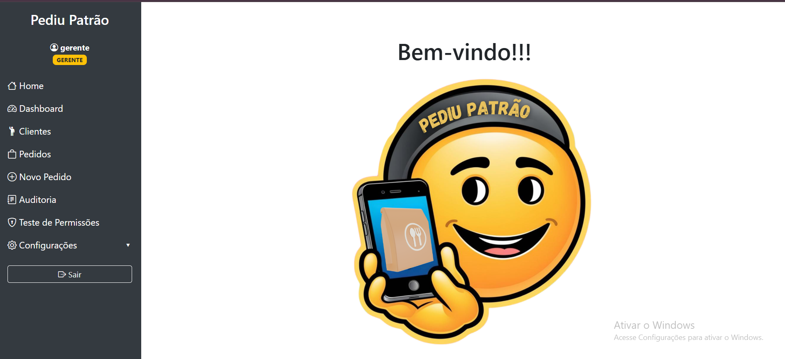
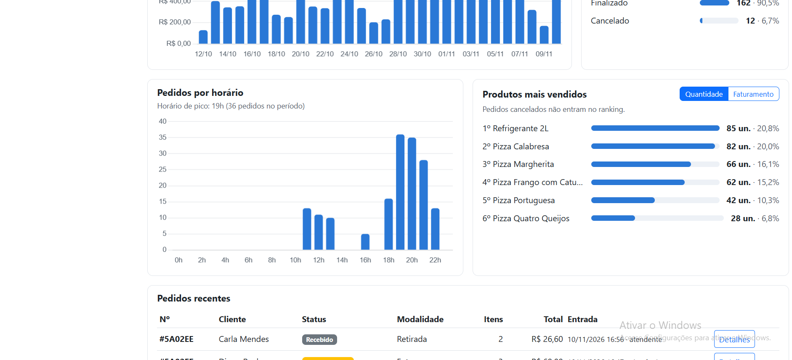
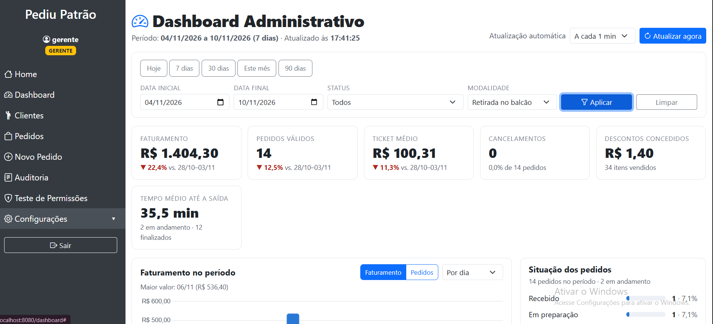
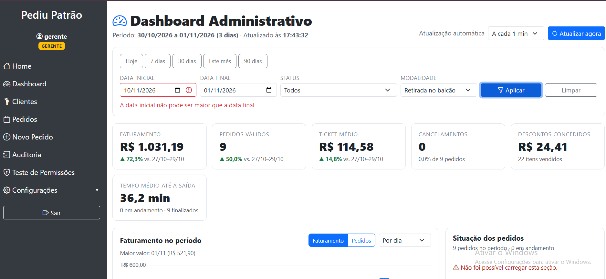

# Evidências de testes — Dashboard Administrativo

## Resultado (execução de 10/11/2026)

| Verificação | Resultado |
|---|---|
| Testes automatizados (`mvnw test`) | **53 testes, 0 falhas, 0 erros — BUILD SUCCESS** (26 novos do dashboard + 27 da Parte 2) |
| Testes da API no sistema rodando | **24 de 24 casos com o código HTTP esperado** |
| Dashboard no navegador | Funcionando com os perfis GERENTE e ADMIN; bloqueado para ATENDENTE |

Os testes foram organizados em níveis, do mais isolado ao sistema inteiro rodando:

| Nível | O que verifica | Ferramenta | Evidência |
|---|---|---|---|
| 1. Unitário | Regras de cálculo e validação de filtros, sem banco | JUnit 5 + Mockito | [01-testes-automatizados.txt](evidencias/01-testes-automatizados.txt) |
| 2. API (camada HTTP) | Segurança, formato JSON e erros dos endpoints | MockMvc + Spring Security Test | [01-testes-automatizados.txt](evidencias/01-testes-automatizados.txt) |
| 3. Sistema rodando | Endpoints reais com MongoDB, login e dados de demonstração | Script `scripts/gerar-evidencias.ps1` | [02-testes-api.md](evidencias/02-testes-api.md) e [api/](evidencias/api/) |
| 4. Tela | Dashboard funcionando no navegador | Teste manual com capturas de tela | [telas/](evidencias/telas/) |

Para gerar de novo as evidências 1 a 3 (com o sistema ligado):

```bat
powershell -ExecutionPolicy Bypass -File scripts\gerar-evidencias.ps1
```

---

## 1 e 2. Testes automatizados

Comando: `mvnw test`. Saída completa: [evidencias/01-testes-automatizados.txt](evidencias/01-testes-automatizados.txt).

### Novos testes do dashboard

**`DashboardServiceTest`** (unitário). Usa uma massa pequena e conhecida, para que cada número possa ser conferido à mão:

| Pedido | Status | Data | Itens | Total |
|---|---|---|---|---|
| p1 | Finalizado (saída em 40 min) | 02/11 19h | 2× Calabresa a R$ 50,00 | R$ 100,00 |
| p2 | Finalizado (saída em 30 min) | 03/11 20h | Margherita R$ 45,00 + Refrigerante R$ 12,00, desconto de 10% | R$ 51,30 |
| p3 | **Cancelado** | 03/11 21h | 1× Calabresa | R$ 50,00 (não é venda) |
| p4 | Em preparação | 10/11 19h | 1× Refrigerante | R$ 12,00 |
| anterior | Finalizado | 25/10 | 1× Portuguesa | R$ 81,65 |

| Teste (12, todos passando) | Requisito | O que comprova |
|---|---|---|
| `indicadoresSomamSomentePedidosNaoCancelados` | RF01 | Faturamento R$ 163,30 (sem o cancelado), ticket médio R$ 54,43, descontos R$ 5,70, 5 itens, taxa de cancelamento 25%, tempo médio até a saída 35 min |
| `indicadoresComparamComPeriodoAnterior` | RF01 | Período anterior de mesmo tamanho (22–31/10); faturamento +100%, pedidos +200%, ticket −33,3% |
| `semPeriodoAnteriorAVariacaoFicaNula` | RF01/RF07 | Sem base de comparação, a variação fica vazia em vez de dividir por zero |
| `pedidoAntigoSemValoresNaoQuebraOsCalculos` | RF07 | Pedido sem status, sem itens e sem valor é tratado sem erro |
| `vendasPorDiaTrazemTodosOsDiasInclusiveSemVenda` | RF02 | 10 pontos para 10 dias; dia sem venda aparece com zero |
| `vendasPorSemanaComecamNaSegundaFeira` | RF02 | Agrupamento semanal começando na segunda-feira |
| `vendasPorMesUsamRotuloEmPortugues` | RF02 | Rótulos `out/2026` e `nov/2026` |
| `vendasPorHoraMostramAs24Horas` | RF02 | 24 horas; o cancelado conta em "cancelados" e não em "pedidos" |
| `situacaoListaTodosOsStatusComPercentual` | RF03 | Os 7 status aparecem; Finalizado = 2 (50%) |
| `rankingPorQuantidadeIgnoraCancelados` | RF04 | Calabresa em 1º com 2 un. (a cancelada não conta); desempate pelo nome |
| `rankingPorFaturamentoOrdenaPeloValor` | RF04 | Ordenação por R$ e participação de 59,2% |
| `limiteForaDoIntervaloEhRecusado` | RF04/RF07 | Limite 0 ou 51 é recusado |

**`FiltroDashboardTest`** (unitário, RF05, 7 testes passando):

| Teste | O que comprova |
|---|---|
| `semDatasUsaUltimos30Dias` | Sem datas, o período é dos últimos 30 dias |
| `aceitaStatusEModalidadeEmMinusculas` | `finalizado` e `retirada` são aceitos |
| `dataEmFormatoErradoGera400NoCampoCerto` | `10/11/2026` é recusado e o erro aponta o campo `inicio` |
| `inicioMaiorQueFimEhRecusado` | Data inicial maior que a final é recusada |
| `periodoMaiorQue366DiasEhRecusado` | Período acima do limite é recusado |
| `statusInexistenteEhRecusado` | `ENTREGUE` é recusado e o erro aponta o campo `status` |
| `periodoAnteriorTemOMesmoTamanho` | 01–10/11 compara com 22–31/10 |

**`DashboardApiTest`** (camada HTTP, RF06 e segurança, 7 testes passando):

| Teste | O que comprova |
|---|---|
| `semLoginRecebe401` | API sem login responde 401 |
| `atendenteNaoAcessaODashboard` | ATENDENTE recebe 403 na API e na página |
| `gerenteRecebeIndicadoresNoEnvelopePadrao` | Resposta 200 com `filtros`, `geradoEm` e `dados` |
| `dataInvalidaRetorna400ComOCampo` | Erro 400 em JSON com `campo` e `mensagem` |
| `limiteNaoNumericoRetorna400` | `limite=abc` responde 400 |
| `dashboardEhSomenteLeitura` | `POST` na API responde 403 |
| `paginaDoDashboardAbreParaOGerente` | A página `/dashboard` é renderizada para o GERENTE |

### Testes que já existiam (Parte 2)
`StatusPedidoTest`, `PedidoServiceTest`, `AuditoriaServiceTest` e `SegurancaApiTest` continuam passando, o que mostra que o dashboard não quebrou as regras de pedidos, auditoria e segurança.

---

## 3. Testes da API no sistema rodando

O script faz login de verdade (com token CSRF) como gerente, admin e atendente e chama os endpoints no servidor ligado com o MongoDB. Cada resposta é salva em [evidencias/api/](evidencias/api/) e o resumo fica em [evidencias/02-testes-api.md](evidencias/02-testes-api.md).

| Casos | Cobertura |
|---|---|
| API-01, API-02, API-24 | Sem login (401) e perfil sem permissão (403) |
| API-03 a API-16 | Todos os endpoints respondendo 200 para GERENTE e ADMIN, com período padrão, período explícito, agrupamentos e filtros de status e modalidade |
| API-17 a API-22 | Erros de validação: data inválida, início maior que fim, período acima de 366 dias, status inexistente, limite não numérico, agrupamento inválido (400) |
| API-23 | API somente leitura: `POST` com token CSRF válido é negado (403) |

---

## 4. Dashboard funcionando (telas)

Capturas feitas com o sistema rodando e os pedidos de demonstração, logado como gerente:

| Captura | O que mostra |
|---|---|
|  | Indicadores (RF01), gráfico de vendas (RF02) e situação dos pedidos (RF03) |
|  | Pedidos por horário (RF02) e produtos mais vendidos (RF04) |
|  | Filtros aplicados (RF05): período de 7 dias e modalidade Retirada |
|  | Tratamento de erro (RF07): data inicial maior que a final |
